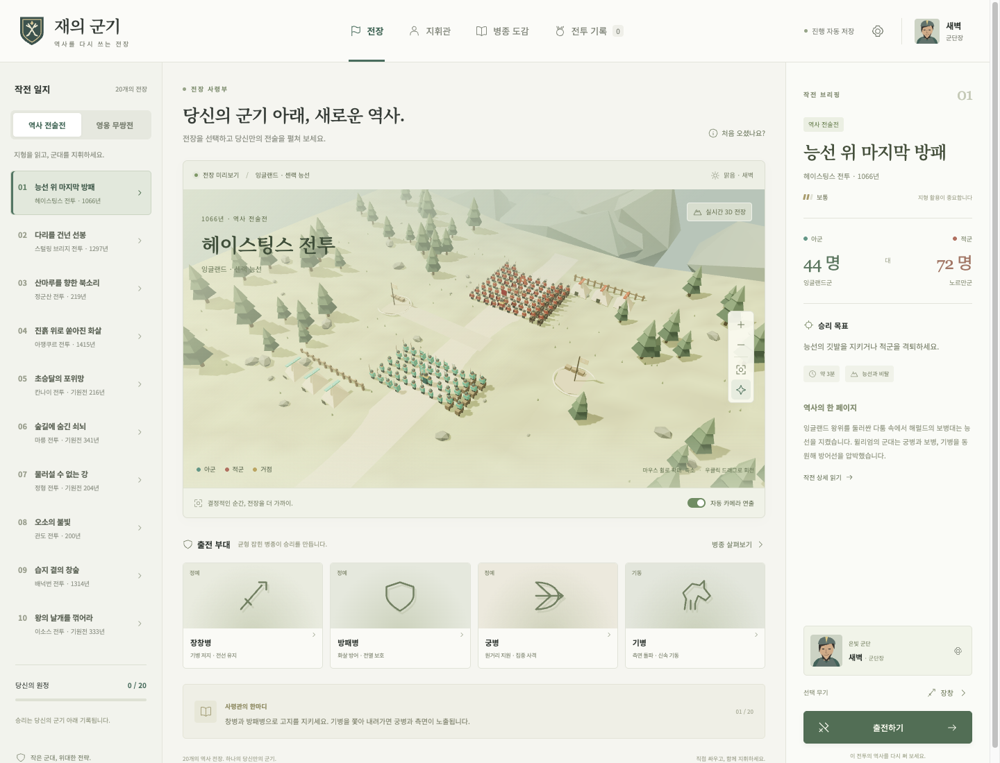
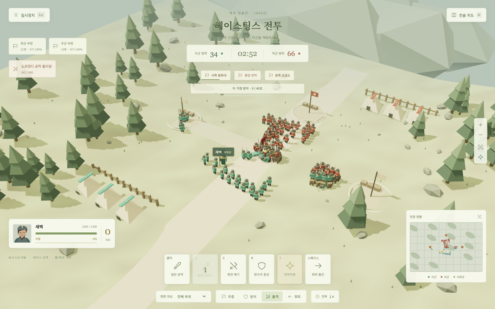
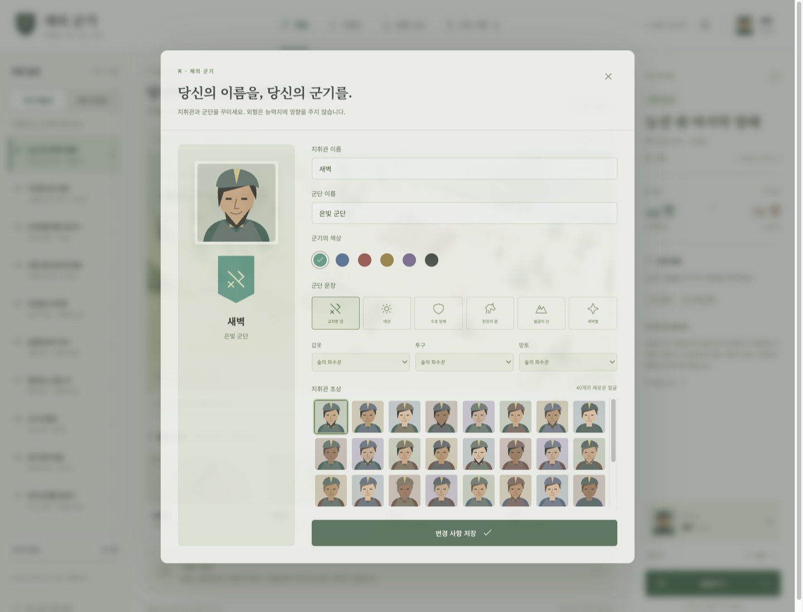
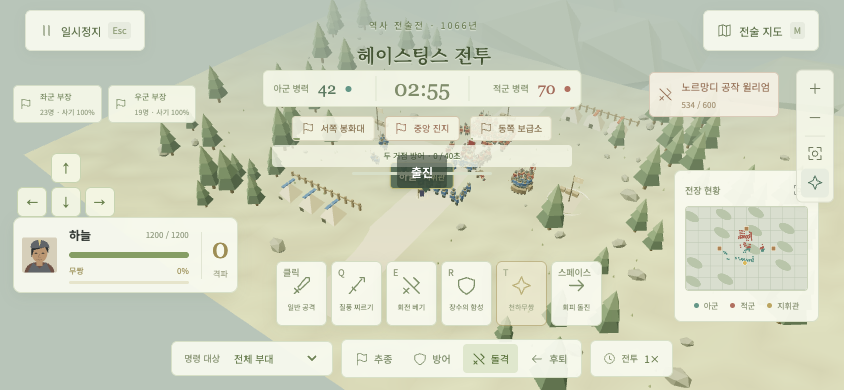

# 재의 군기 · Banners of History

> 당신의 군기 아래, 새로운 역사.

**재의 군기**는 지휘관을 직접 조작하면서 군대를 지휘하는 Three.js 기반 역사 액션·전술 게임입니다. 역사 전술전 10개와 영웅 무쌍전 10개에서 병종과 지형을 활용하고, 거점을 차지하거나 아군을 호송하며 전투 목표를 달성하세요.

**[지금 웹에서 플레이하기](https://gyuha.com/banners-of-history/)** · [조작법](#조작법) · [개발 문서](docs/README.md)

설치나 회원가입 없이 브라우저에서 실행할 수 있습니다. 메뉴와 게임 설명은 한국어로 제공됩니다.



## 주요 특징

| 요소 | 내용 |
| --- | --- |
| 20개의 역사 전장 | 헤이스팅스, 스털링 브리지, 정군산, 거록, 합비, 장판 등 |
| 두 가지 플레이 방식 | 부대 운용이 중요한 역사 전술전과 강력한 지휘관을 조작하는 영웅 무쌍전 |
| 실시간 전투와 지휘 | 지휘관 이동·공격·회피와 전체 부대·병종·좌우 부장별 명령 |
| 병종과 지형 | 장창병·방패병·궁병·기병·검병·도끼병, 능선·숲·습지·교량 |
| 다양한 전투 목표 | 거점 점령·방어, 적장 제압, 습격 후 귀환, 보호 대상 호송 |
| 상황별 카메라 | 출전·돌격·기술·거점 점령·위기·승패에 따른 확대·축소와 시점 이동 |
| 지휘관 꾸미기 | 초상 40개, 무기 8종, 군기 색상·문장, 갑옷·투구·망토 조합 |
| 전투 기록 | 전투별 업적 5개, 전체 100개 업적과 승리 기록 자동 저장 |
| 반응형 화면 | 데스크톱 UI와 모바일 가로 화면의 이동·공격·기술 버튼 |

마우스 휠과 화면의 카메라 버튼으로 직접 확대·축소할 수 있습니다. 자동 카메라 연출은 설정에서 켜거나 끌 수 있습니다.

## 스크린샷

아래 이미지는 실제 게임을 브라우저에서 실행해 캡처한 화면입니다.

### 실시간 전투

지휘관을 직접 조작하고, 부장과 병종에 명령을 내려 전선을 유지합니다. 생명력·무쌍 게이지·기술 재사용 시간·미니맵으로 전투 상황을 확인할 수 있습니다.



| 지휘관과 군기 꾸미기 | 모바일 가로 화면 |
| --- | --- |
|  |  |

모바일 화면은 가로 뷰포트와 터치 에뮬레이션으로 확인했습니다. 스크린샷 파일은 [`docs/screenshots`](docs/screenshots)에 있습니다.

## 처음 플레이할 때

1. **역사 전술전** 또는 **영웅 무쌍전**을 선택합니다.
2. 전투 목록에서 전장을 고르고 브리핑의 승리 목표와 전술 조언을 확인합니다.
3. 지휘관·군기·무기를 준비하고 **출전하기**를 누릅니다.
4. 지휘관을 움직이며 공격하고, 부대에 **추종·방어·돌격·후퇴** 명령을 내립니다.
5. 전투 목표를 달성하면 결과와 획득한 업적이 저장됩니다.

역사 전술전에서는 병종 상성과 전열 유지가 중요합니다. 영웅 무쌍전에서는 밀집한 적에게 기술을 명중시켜 무쌍 게이지를 모으고 전선을 돌파하세요.

진행 상황과 설정은 현재 브라우저의 `localStorage`에 저장됩니다. 다른 기기·브라우저·접속 주소의 기록과는 별도로 관리됩니다.

## 조작법

| 입력 | 동작 |
| --- | --- |
| `W A S D` / 방향키 | 지휘관 이동 |
| 마우스 왼쪽 버튼 | 일반 공격 |
| `Q` | 질풍 찌르기 |
| `E` | 회전 베기 |
| `R` | 장수의 함성 — 체력 회복·주변 아군 지원 |
| `T` | 천하무쌍 — 게이지가 가득 찼을 때 사용 |
| `Space` | 회피 돌진 |
| 마우스 휠 / 화면의 `+`, `−` | 카메라 확대·축소 |
| 마우스 오른쪽 버튼 드래그 | 카메라 회전 |
| `M` | 전술 지도 전환 |
| `Esc` | 일시정지·메뉴 닫기 |

화면 아래에서 명령할 부대를 선택한 뒤 추종·방어·돌격·후퇴 버튼을 누릅니다. 부장 카드로 좌익과 우익의 지휘권을 선택할 수도 있습니다. 모바일에서는 화면의 이동 패드와 공격·기술 버튼을 사용하세요.

## 로컬에서 실행하기

**필요 환경:** Node.js 22.12 이상, npm, WebGL을 지원하는 브라우저. GitHub Actions에서는 Node.js 24를 사용합니다.

```sh
git clone https://github.com/gyuha/banners-of-history.git
cd banners-of-history
npm ci
npm run dev
```

개발 서버 주소: **http://localhost:5173/banners-of-history/**

### 테스트와 프로덕션 빌드

```sh
# 전투·지형·AI·복합 목표·저장·업적 테스트
npm test

# 정적 배포 파일 생성
npm run build

# 빌드한 게임을 로컬에서 확인
npm run preview
```

빌드 결과는 `dist/`에 생성되며, 미리보기 주소는 **http://localhost:4173/banners-of-history/** 입니다.

## GitHub Pages 배포

**공개 주소:** https://gyuha.com/banners-of-history/

`main`에 푸시하면 [배포 워크플로](.github/workflows/deploy-pages.yml)가 의존성 설치, 테스트, 빌드와 GitHub Pages 배포를 순서대로 수행합니다. [Actions 탭](https://github.com/gyuha/banners-of-history/actions/workflows/deploy-pages.yml)에서 수동으로 실행하거나 배포 결과를 확인할 수 있습니다.

GitHub Pages 기본 주소인 https://gyuha.github.io/banners-of-history/ 도 기존 연결 도메인 `gyuha.com`으로 이동합니다. 이미지·글꼴·홈 링크가 저장소 하위 경로에서 동작하도록 Vite의 `base`를 `/banners-of-history/`로 설정했습니다.

설정과 장애 확인 방법은 [GitHub Pages 배포 문서](docs/05-github-pages.md)를 참고하세요.

## 기술 구성

- **Three.js:** 전장과 병사 모델, 애니메이션, 카메라, 타격 효과.
- **JavaScript ES Modules:** 전투 시뮬레이션, AI, 목표 판정과 UI 상태.
- **HTML·CSS:** 한국어 사령부, 전투 HUD, 모달과 반응형 레이아웃.
- **Web Audio API:** 전투·지휘 효과음 합성.
- **Vite:** 개발 서버와 정적 빌드.
- **Node.js Test Runner:** 전투·저장·업적 로직 검증.
- **GitHub Actions·Pages:** 자동 테스트와 웹 배포.

별도의 게임 서버나 데이터베이스 없이 정적 파일로 실행됩니다.

## 프로젝트 구조

```text
banners-of-history/
├── .github/workflows/deploy-pages.yml  # 자동 테스트·배포
├── public/assets/                    # 키아트·문장·한국어 글꼴
├── src/
│   ├── battles.js                    # 전투 20개와 병종 데이터
│   ├── engine.js                     # Three.js 장면·전투·AI·카메라
│   ├── main.js                       # 사령부·HUD·메뉴·입력 연결
│   ├── progress.js                   # 지휘관·장비·저장·업적
│   └── style.css                     # 게임 UI와 반응형 스타일
├── tests/                            # 전투·진행 데이터 자동 테스트
├── tools/                            # Ego Lite 검증·글꼴 준비 도구
├── docs/                             # 조사·구현·배포·검증 문서
│   ├── evidence/                     # 조사·검증 근거
│   └── screenshots/                  # README 스크린샷
├── index.html
└── vite.config.js
```

## 개발 문서와 검증

| 문서 | 내용 |
| --- | --- |
| [개발 문서 목차](docs/README.md) | 이후 개발을 위한 자료 안내 |
| [원작 조사](docs/01-reference-investigation.md) | 관찰 범위, 기능과 근거, 확인되지 않은 사항 |
| [구현 가이드](docs/02-implementation-guide.md) | 모듈 구조, 엔진 API, 저장과 확장 방법 |
| [전투·균형 대조](docs/03-battles-and-balance.md) | 전투 20개의 역사적 맥락, 원작 관찰과 새 구현의 차이 |
| [검증 보고서](docs/04-validation.md) | 자동 테스트 26개와 실제 브라우저 플레이·모바일 검증 |
| [배포 가이드](docs/05-github-pages.md) | Pages 설정, 리소스 경로와 공개 페이지 확인 결과 |
| [리소스 제작 기록](docs/asset-generation.md) | 신규 리소스 제작 방식, 이미지 생성 프롬프트와 글꼴 출처 |

## 참고 작품과 리소스

[Song of Ashes / Heroes Battlefield Demo](https://hank1105.itch.io/heroes-battlefield-demo)의 주요 플레이 흐름을 조사해 화면 구성과 한국어 UI를 새로 설계했습니다. 전투 규모·수치·일부 목표는 이번 게임의 플레이에 맞게 재구성했으며, 상세 차이는 [전투·균형 대조 문서](docs/03-battles-and-balance.md)에 기록했습니다.

전장·병사·초상·군기·아이콘은 코드로 제작했고, 효과음은 Web Audio로 합성합니다. 키아트는 새로 생성한 이미지입니다. 한국어 글꼴은 SIL Open Font License 1.1로 배포되는 Noto Sans KR·Noto Serif KR을 사용하며, 라이선스 원문을 [`public/assets/fonts`](public/assets/fonts)에 포함했습니다. 원작 조사 파일은 `docs/evidence`에 보관하며 실행용 빌드에는 포함하지 않습니다.
