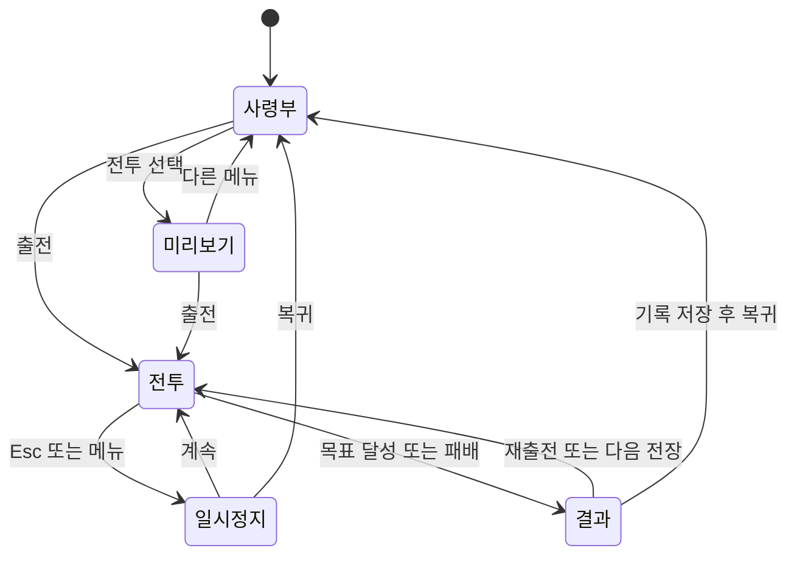

# 구현 구조와 이후 개발 가이드

이 문서는 원작 조사 결과를 바탕으로 직접 작성한 Three.js 게임 **재의 군기**의 현재 구조를 설명한다. 원작 사실은 `01-reference-investigation.md`, 시나리오별 대조는 `03-battles-and-balance.md`를 먼저 확인한다. 조사 대상의 코드나 이미지는 실행 제품에 포함하지 않는다.

## 실행과 파일 구조

```sh
npm install
npm run dev -- --port 5173
npm test
npm run build
npm run preview -- --port 4173
```

Node.js 22.12 이상을 권장한다. `package-lock.json`에 실제 설치 버전을 고정했다. 개발 서버는 Vite, 실행 엔진은 Three.js이며 데이터베이스나 계정은 필요하지 않다. `dist`를 일반적인 정적 웹 호스팅에 올릴 수 있다. `file://` 직접 열기는 ES 모듈과 리소스 경로 때문에 지원하지 않는다.

| 경로 | 책임 |
|---|---|
| `index.html` | 한국어 문서, 반응형 viewport, 검색 설명, 진입점 |
| `src/main.js` | 사령부 화면, 모달, 입력 UI, 전투 HUD, 미니맵, 결과·진행 기록 |
| `src/engine.js` | 전장/모델 생성, AI, 충돌과 지형 효과, 피해·스킬·거점, 카메라, 음향 |
| `src/battles.js` | 역사 전술전 10개, 영웅 무쌍전 10개, 병종 6개의 한국어 데이터 |
| `src/progress.js` | 저장 스키마와 복구, 업적 계산, 무기/초상/장비 테마/문장 목록 |
| `src/style.css` | 사령부·전장·모달·터치 화면·반응형 레이아웃 |
| `public/assets` | 직접 만든 SVG 군기 및 신규 생성 키아트 |
| `tests` | 실제 시뮬레이션 로직과 저장·업적·시나리오 데이터 검증 |
| `docs/evidence` | 원작 관찰 기록, REA 결과, 구현 검증 기록과 스크린샷 |

## 화면 방향

청록색 군기, 산림색과 종이색 배경, 황동색 강조를 사용한다. 원작의 진한 화면을 그대로 복사하지 않고 정보 위계를 새로 구성했다.

- 왼쪽: 모드 선택, 전투 10개 목록, 원정 완료 비율.
- 가운데: 현재 전장 제목, 조작 가능한 실제 3D 미리보기, 병종 카드, 전술 조언.
- 오른쪽: 상대 병력, 역사 배경, 승리 목표, 지휘관, 무기, 출전 버튼.
- 전투 중: 3D 장면을 전체 화면으로 펼치고 위에는 목표·병력·시간, 아래에는 영웅 생명력·무쌍·기술·명령, 우측에는 미니맵을 배치한다.
- 1020px 이하에서는 브리핑을 가운데 아래로 이동한다. 740px 이하에서는 전투 목록이 가로로 스크롤된다. 휴대전화에서는 가로 화면을 권장하며 이동 버튼과 공격·기술 버튼을 제공한다.

메뉴·설명·도감·알림은 한국어다. WASD, Q/E/R/T, M, Esc는 키 이름이다. 초상은 40개의 절차 생성 SVG 조합이며 원작 초상 이미지와 무관하다. 군단 문장 6개, 색상 6개, 갑옷·투구·망토 각각 장비 테마 8개를 조합한다. 장식 장비는 전투 수치에 보너스를 주지 않는다. 선택한 색상과 문장은 전장 모델에도 반영된다.

## 상태 흐름



렌더러는 페이지 수명 동안 하나를 유지한다. 메뉴/전장 전환 시 캔버스를 새로 만들지 않고 레이아웃과 전장 상태를 바꾼다. 모달을 열면 시뮬레이션을 멈추며 닫으면 이어간다. 창 포커스를 잃을 때도 일시정지한다. 출전마다 세션 번호를 증가시켜 이전 전투의 지연된 결과 창이 새 전투를 덮지 못하게 한다.

## 엔진 인터페이스

```js
const field = new Battlefield(container, {
  onUpdate(state) { /* HUD: 약 8Hz */ },
  onEvent(event) { /* 알림과 결과 */ },
  settings: { cinematic: true, quality: 'high', sound: true },
});
field.preview(battle, options);
field.start(battle, {
  weapon: 'spear', banner: '#359e8b', difficulty: 'normal', crest: 'sun',
  appearance: { armor: '#59736c', helmet: '#52645b', cape: '#2b6d59' },
});
field.command('hold', 'left');
field.skill('e');
```

공개 메서드: `preview`, `start`, `command`, `skill`, `setPaused`, `setSpeed`, `setZoom`, `setCinematic`, `setQuality`, `setSound`, `focusHero`, `setMapMode`, `selectUnit`, `resize`, `getState`, `dispose`.

명령은 `follow`, `hold`, `charge`, `retreat`. 대상은 `all`, `left`, `right` 또는 병종 ID이다. 좌·우 부대는 최초 편성 시 지정하므로 전투 중 위치가 바뀌어도 지휘권의 범위가 유지된다. `state.lieutenants`의 병력과 생명력/사기 표시는 해당 부대 생존 병사들의 현재 체력 평균이다. 별도 심리 사기 시뮬레이션으로 오인하지 않는다.

`state`는 실행/일시정지, 시간, 생명력, 무쌍, 격파/연격, 양군 잔여 수, 기술 재사용 시간, 명령, 병종별 집계, 거점, 병사 좌표, 영웅 좌표·화면 좌표, 부장, 카메라 거리, FPS를 제공한다. `soldiers`의 `team`은 아군 `1`, 적군 `2`이다. 미니맵이 이 값을 동일하게 읽어야 한다. 거점 점령 진행은 `-100`부터 `100`까지이며 부호가 진영을 나타낸다.

`window.__BANNER_DEBUG__`는 읽기 전용 관찰 함수만 노출한다. `getState`, `getSelection`, `getSave`, `getBattle`, `version`을 브라우저 QA에서 사용할 수 있다. 사용자에게 치트나 상태 강제 변경 기능은 제공하지 않는다.

## 시뮬레이션과 3D 리소스

병사는 몸통/머리/투구/다리/무기/방패를 Three.js 기본 지오메트리로 만들고, 기병은 말 몸체를 추가한다. 영웅은 더 크게 만들고 발밑의 금빛 고리와 머리 위 명패로 구분한다. 식생, 암석, 텐트, 울타리, 목재 교량, 군기와 문장도 코드에서 생성한다.

공유 지오메트리와 재질을 캐시하고 정적인 몸통/장비/나무 부품을 병합한다. 다리와 무기 팔은 별도로 움직인다. 장면 변경 시 지면처럼 개별 생성한 지오메트리는 해제하고 공유 캐시는 유지한다. 마지막 `dispose()`는 입력 리스너, ResizeObserver, requestAnimationFrame, WebGL 자원과 오디오를 해제한다.

- 렌더링: `requestAnimationFrame`, 시간 변화량 최대 0.05초, 전투 속도 1/1.5/2배.
- 병력 수: 현재 시나리오의 12~100명 규모를 실제 개체로 표현한다. 수천 명의 원작 수치를 그대로 복제하지 않는다.
- AI: 가까운 적을 탐색하고 병종 사거리·속도·공격력에 따라 접근/공격한다. 궁병은 투사체를 표시한다. 장창병은 기병에 추가 피해를 준다.
- 지형: 오르막 이동 감소, 습지 이동 감소(기병 더 크게), 숲 기동/사거리 감소, 강 수면 충돌과 교량 경로.
- 거점: 반경 내 병력 우세로 점령 진행. 영웅은 일반 병사 여러 명에 해당하는 점령 기여도를 가진다.
- 병사 피해·사망은 실제 상태로 계산한다. 영웅 사망은 패배다. 제한 시간이 지나면 해당 목표가 미달성인 공격 임무는 패배한다.
- 음향: Web Audio 발진기로 합성한다. 외부 음원은 쓰지 않는다. 소리는 사용자의 조작 후 재생되며 음소거할 수 있다.

병종의 도감 수치는 `TROOPS`를 엔진에서도 직접 읽는다. 밸런스를 바꿀 때 도감과 시뮬레이션이 어긋나지 않게 이 데이터만 먼저 고친다.

## 카메라

원근 카메라를 비스듬히 내려다보는 기본 시점으로 시작한다. 카메라 위치와 주시점을 지수 보간해 확대/축소를 부드럽게 연결한다. 수동 휠은 0.65~1.65 배율로 제한하며 우클릭 드래그로 회전한다.

- 출전: 전장과 병력을 보여주는 넓은 시점.
- Q/E·무쌍: 영웅을 중심으로 확대하여 타격과 범위를 강조.
- 아군 회복/돌격: 주변 전열까지 읽을 수 있게 시점을 조절.
- 거점 점령: 해당 군기를 중심으로 잠시 이동.
- 위기: 저체력 영웅에 주목하고 한 번 경고.
- 승리/패배: 마지막 전장을 보여주고 결과 화면으로 이동.
- 전술 지도: 높은 위치에서 전장을 내려다본다. 이 상태에서도 부대에 명령할 수 있다.

자동 연출을 끄더라도 수동 확대/축소와 영웅 집중은 작동한다. 접근성 측면에서 CSS의 `prefers-reduced-motion`은 메뉴 전환을 단순화하고, 카메라 연출은 별도 설정으로 끈다.

## 저장과 업적

브라우저 `localStorage`의 키는 `banner-of-ashes-v1`이다. 저장 버전은 1이다.

```js
{
  version: 1,
  name: '새벽', company: '은빛 군단', portrait: 0,
  banner: '#359e8b', crest: 'swords', weapon: 'spear',
  equipment: { armor: 'forest', helmet: 'forest', cape: 'forest' },
  victories: { /* 전투 ID: {time, kills} */ },
  achievements: { /* 전투 ID: [달성 여부 5개] */ },
  totalKills: 0, lastBattle: 1,
  settings: { cinematic: true, sound: true, quality: 'high', difficulty: 'normal' }
}
```

`normalizeSave`는 잘못된 JSON, 잘못된 색상/무기/초상/장비 값, 범위 밖 전투 ID를 복구한다. 접근 차단이나 저장 용량 오류는 게임 실행을 중단시키지 않는다. 이름은 HTML 출력 전에 이스케이프한다. 지휘관 편집은 임시 초안을 사용하므로 저장을 누르기 전에 닫으면 변경이 적용되지 않는다.

업적은 전투마다 5개, 전체 100개다. 승리, 제한 시간 70% 내 승리, 체력 50% 이상, 개인 15명 이상 격파, 아군 50% 이상 생존 조건을 쓴다. 재도전으로 이미 얻은 업적을 잃지 않는다. 원작의 전투별 서로 다른 5개 업적과 동등한 세부 규칙은 아니며 후속 확장 지점이다.

## 이후 확장 순서

1. `docs/01`, `03`의 원작 관찰 근거와 차이를 먼저 확인한다.
2. 시나리오 특유의 인물/호송/귀환 목표를 추가할 때 `objectiveStatus`와 실제 완료 조건을 함께 변경한다.
3. 새 병종은 데이터, 모델, AI 상성, 명령 대상, 도감, 미니맵을 함께 연결한다.
4. 추가 무기는 일반 공격과 기술의 거리/피해/효과뿐 아니라 UI 설명도 함께 바꾼다.
5. 저장 구조가 바뀌면 스키마 이행을 넣고 손상된 저장과 이전 저장을 테스트한다.
6. 변경한 지형이나 목표의 로직 테스트를 먼저 실행하고 실제 Ego Lite 플레이로 렌더링·입력·승패·모바일을 확인한다.

계정/서버 저장, 상대 진영 선택, 원작의 고급 병종 세부 계통과 정확한 역사 병력, 원작과 동일한 특수 업적, 기마 지휘관과 마갑 선택은 후속 확장 범위다. 현재 제품은 브라우저 단독 실행 게임이다.

## 전투별 복합 목표 인터페이스

현재 엔진은 공용 목표 외에 `battle.id`에 따라 다음 규칙을 선택한다. `src/battles.js`의 화면 설명과 함께 수정해야 한다.

| 전투 | 내부 목표 모드 | 실제 완료 조건 |
|---|---|---|
| 13 합비, 16 하서 | `raid-return` | 좌·우 거점 각 한 번 확보 후 영웅이 남쪽 본진(`z > 31`)으로 귀환 |
| 14 곤양, 19 호뢰 | `commander-rout` | 이름을 가진 적장 격파와 최초 적 병력 30% 이상 격파를 모두 충족 |
| 15 장판 | `escort` | 중앙 구출 후 피난민·부상병 실제 NPC 둘 모두 본진 귀환. 한 명 사망 시 패배 |
| 17 막북, 20 언성 | `strength-rout` | 병사별 남은 체력 비중 합계가 최초 병력의 20% 이하 |

`getState().objectiveStatus`는 `{label, progress, complete, returnRequired}`를 반환한다. HUD의 목표 문장과 진행 막대는 이를 직접 사용한다. 적장은 기존 병력 중 한 명을 지정해 총 병력 수가 늘어나지 않는다. `enemyCommander`는 이름·생명력·위치·생존 여부를, `escorts`는 이름·생명력·위치·구출/귀환 상태를 제공한다. 적 AI가 호송 대상을 실제 공격하며 R 기술로 아군과 호송 대상을 회복할 수 있다.

복합 목표는 단순 적 전멸로 건너뛰지 않는다. 전투 시간이 끝났을 때 목표가 미완료이면 패배한다. `hold`는 두 거점의 **연속** 40초 확보가 필요하며 중간에 잃으면 유지 시간이 0으로 돌아간다. 별도로 제한 시간 종료 시 거점 하나 이상을 유지하면 방어 임무를 성공한다.

무쌍은 실제 명중·격파·거점 점령으로 충전한다. 빗나간 기술이나 대기 시간으로는 충전하지 않으며, 무쌍 기술의 자체 타격은 사용한 게이지를 다시 채우지 않는다. 전술전의 지휘관 개인 피해는 영웅전 기준의 40%로 설정해 병종·진형 지휘의 비중을 높였다.
